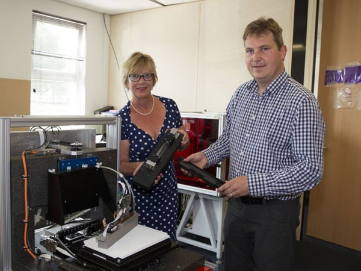
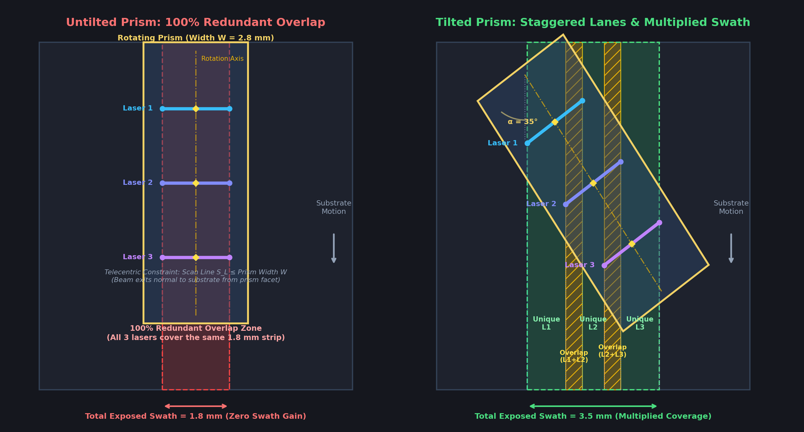

# History

::: {.callout-tip appearance="simple"}
## ⏱️ The Hexastorm Journey at a Glance

| Era | Milestone | Technical Breakthrough |
|:---|:---|:---|
| **2013** | **Origins at TNO** | Multi-beam prism conceived for PCB lithography ([US10114289B2](https://patents.google.com/patent/US10114289B2)), but constrained by fiber bundling and acoustic siren drag. |
| **2017** | **The Open-Hardware Pivot** | Rik Starmans (co-inventor) confirms single-beam freedom to operate, founding Hexastorm as an unencumbered open-hardware platform. |
| **2019** | **Hackaday Prize Finalist** | While working as an optical scientist at [NTS Optel](https://www.nts-group.nl/), Rik built a working Beaglebone prototype at home, demonstrating [live raster exposure](https://youtu.be/SofTXG5s_MA) and winning a Hackaday Prize award. |
| **2021–2023** | **FPGA & Planar PCB Motors** | Migrated core to cycle-accurate [Amaranth HDL](https://amaranth-lang.org/); proved a flat PCB stator can directly spin an ultra-thin 2 mm quartz polygon. |
| **2025** | **Sub-60 µm Precision** | Deterministic photodiode debounce and computer vision calibration break the **sub-60 micron resolution** barrier on photo paper. |
| **2026** | **CNC 3018 Desktop Integration** | Unified into the 4-layer [Firestarter](https://github.com/hstarmans/firestarter) board (sponsored by PCBWay) as a plug-and-play LDI drop-in for standard CNC 3018 frames. |
:::

## Origins at TNO (2013–2017)

The project started in 2013 when [TNO](https://tno.nl) researched alternative approaches for printed circuit board lithography. TNO is the prominent national research institute in the Netherlands, located in the heart of the Dutch high-tech ecosystem centered around [ASML](https://asml.com).

Once a laser is focused to a microscopic spot, it must be swept rapidly to expose a plane. The beam can be deflected by mirrors or prisms:

* **Rotating prisms** exhibit significantly lower cross-scan error and enable simpler, flat-field optics without requiring expensive f-theta scan lenses (detailed in the [Hexastorm optical design repository](https://github.com/hexastorm/opticaldesign)).
* **Galvanometers and polygon mirrors** suffer from mechanical inertia, non-linear velocity profiles, or severe optical distortions.

Around 2013, Erwin van Zwet suggested using a prism in an oscillating sweeping motion, similar to a galvo mirror. Dr. Jacobus Jamar improved on the concept by proposing a continuously rotating prism combined with multiple laser beams under an angle, resulting in TNO patent [US10114289B2](https://patents.google.com/patent/US10114289B2) (and [WO2015160252A1](https://patents.google.com/patent/WO2015160252A1)). This multi-beam concept was inspired by the earlier Kleo LDI system originally developed by [Carl Zeiss](https://www.zeiss.com) (patented under [US8314921B2](https://patents.google.com/patent/US8314921B2)), later acquired by [Manz](https://www.manz.com/) (whose engineering assets and facilities were acquired by [Tesla](https://www.tesla.com/) Automation in 2025).

The patent was split into two separate commercial applications: printed circuit board lithography and 3D printing. With TNO support, Peter Brier and Wilma Koolen founded LDI Systems to pursue PCB lithography. However, the company struggled to commercialize the complex multi-beam setup and ceased independent operations.

::: {layout-ncol=2}
)](img/plurality.jpg)

:::

LDI Systems and its patent assets were absorbed by [Innovation Industries](https://www.innovationindustries.com/), the prominent Dutch deep-tech venture fund (widely known for backing [Nearfield Instruments](https://www.nearfieldinstruments.com/), an AFM semiconductor inspection unicorn). 

This corporate history created an important strategic divergence:

* **Why Atum Systems cannot pursue PCBs**: Because the original multi-laser patent's ([US10114289B2](https://patents.google.com/patent/US10114289B2)) PCB rights were tied up in the absorbed LDI Systems entity, TNO's subsequent spin-off (AMSystems, now merged into Atum Systems) was strictly confined to 3D printing.
* **Hexastorm's Freedom to Operate & Co-Inventor Background**: Rik Starmans joined TNO around 2014 and is himself listed as a co-inventor on TNO's patent family ([WO2015160252A1](https://patents.google.com/patent/WO2015160252A1) / [US10114289B2](https://patents.google.com/patent/US10114289B2)). Experiencing first-hand that aligning multiple laser beams through a single rotating prism was an intractable engineering bottleneck, Rik proposed simplifying to a single-beam-per-prism architecture. 
* **The 2017 Legal Certainty**: When the US patent application text was officially published in February 2017 ([US20170038690A1](https://patents.google.com/patent/US20170038690A1)), its examination claims were strictly restricted to a *plurality* of beams through the transmissive element (single-beam prism scanning was already established public-domain prior art by Lindberg in 1966, [US3253498](https://patents.google.com/patent/US3253498)). This provided definitive legal confirmation that Hexastorm's single-beam system had 100% freedom to operate for **high-speed PCB photolithography**.
* **Patents as Public Funding Vehicles**: In institutional environments, keeping such complex multi-beam patents alive is often driven by securing Dutch and European innovation grants and regional venture subsidies (NWO, BOM, and EU frameworks) under the badge of a "unique patent portfolio," rather than serving as a cost-effective manufacturing platform.

::: {.callout-note collapse="true"}
## Deep Dive: The Physics of Multi-Beam Prisms (Tilt Dilemma, Fiber Bundling & Aero-Acoustics)

In the multi-beam concept originally developed for reflective polygon mirrors by [Carl Zeiss](https://www.zeiss.com) / Kleo LDI (patent [US8314921B2](https://patents.google.com/patent/US8314921B2)) and later adapted to refractive prisms by TNO (patent [US10114289B2](https://patents.google.com/patent/US10114289B2)), multiple laser diodes enter along the length of a single rotating optical element.

{fig-align="center" width=95%}

Looking from the top view, the rotating prism appears as a long rectangle spanning the substrate:

* **Why an Untilted Prism Fails (Left)**: If the prism axis is aligned parallel to the substrate feed, each laser sweeps along the exact same transverse track. As the substrate advances, all laser lines sweep over the same narrow strip—100% redundant overlap, producing no increase in exposure swath.
* **Why the Prism Must Be Tilted (Right)**: Tilting the prism relative to the substrate movement staggers the scan lines. As shown in the diagram, each laser diode now exposes a distinct unique zone across the moving substrate, with a calibrated overlap zone between adjacent lanes to ensure seamless stitching without gaps. This multiplies the total exposed swath.

#### The Laser Diode Spacing Dilemma & Fiber Bundling

To stitch adjacent scan lines seamlessly on a moving substrate, the laser diode spacing must match the effective scan length minus the overlap. In multi-beam systems like TNO's prototypes, typical scan line lengths were around **8 mm** with an intentional lane overlap of approximately **2 mm**. 

Geometrically, at an ideal 45° tilt angle, the physical separation between adjacent laser diodes cannot exceed the scan line length ($S_{\text{laser}} \le S_{\text{scan}}$). In commercial systems like the Manz Speedlight 2D (implementing the Zeiss/Kleo multi-beam patent [US8314921B2](https://patents.google.com/patent/US8314921B2)), peripheral lens distortions and telecentric exit constraints forced the tilt angle **below 45°** ($\alpha < 45^\circ$), requiring laser diodes to be packed even closer together than the scan line length. 

Because standard packaged laser diodes (with collimators, anamorphic optics, and heat sinks) cannot physically fit that close together along a glass cylinder, systems like Kleo LDI were forced into **optical fiber bundling**. While technically functional, fiber coupling drastically inflated production costs, introduced optical insertion losses, and compounded assembly fragility.

*(For the complete mathematical proof and trigonometric derivations, see the [foundational RepRap white paper](https://reprap.org/wiki/Open_hardware_fast_high_resolution_LASER#Polygon_tilt_angle) and the [Hexastorm opticaldesign analytical model](https://github.com/hexastorm/opticaldesign)).*

#### The Aero-Acoustic & Inertia Trap

For $N$ laser bundles, the prism must grow substantially in axial length. This creates compounding mechanical and aerodynamic penalties:

* **Atmospheric Siren Noise vs. Cleanroom Vacuum Pumps**: Cleanroom turbomolecular pumps spin silently at 30,000–90,000 RPM because they operate in high vacuum ($< 10^{-3}\text{ mbar}$) with zero air resistance. In atmospheric air, however, a thick multi-beam prism acts as an **acoustic siren**: its rotating facets continuously chop and displace air, generating loud blade-pass siren noise and severe turbulence.
* **Windage Drag**: Aerodynamic drag power scales directly with axial length and the cube of rotational speed ($P_{\text{drag}} \propto L \cdot \omega^3$). Spinning a thick, elongated glass cylinder consumes significant drive power and dumps friction heat directly into the optomechanics, triggering thermal drift.
* **Rotational Inertia & Multi-Plane Balancing**: Added mass multiplies the moment of inertia ($I = \frac{1}{2} m r^2$), demanding heavy spindle motors. Furthermore, an elongated glass cylinder is a 3D rigid rotor: any mass eccentricity between opposite ends causes dynamic couple unbalance (gyroscopic wobbling), requiring complex multi-plane dynamic balancing machines.

Despite having a working platform, backing from [Carl Zeiss](https://www.zeiss.com) and Manz, and substantial German government ([BMBF](https://en.wikipedia.org/wiki/Federal_Ministry_of_Education_and_Research_(Germany))) innovation subsidies, the multi-beam Speedlight 2D struggled commercially against established [DMD](https://en.wikipedia.org/wiki/Digital_micromirror_device) and galvo platforms. The extreme cost of multi-channel fiber bundling, thermal drift, and the acoustic/mechanical complexity of spinning a heavy multi-beam cylinder proved too difficult to commercialize.
:::

### The Hexastorm Thesis: Single Beams & Modular Arrays

Rather than wrestling with the compounding penalties of a tilted multi-beam prism, Hexastorm was founded on a lean, modular architecture:

1. **100% Optical Efficiency (90° Static Tilt)**:  
   Because each Hexastorm module contains only a single beam, there is no line-overlap dilemma. Each module operates at the optimal **90° static tilt angle** relative to substrate feed:
   $$\alpha = 90^\circ \implies \sin(90^\circ) = 1.0$$
   **100% of the optical scan length is converted directly into useful exposure swath**, eliminating the trigonometric cosine/sine projection loss entirely.  
   *(Fun Fact: While the scan head is mounted at a nominal 90° static angle, the actual line traced across a continuously moving substrate is tilted by a fraction of a degree due to the substrate's continuous forward feed. The Hexastorm slicer mathematically compensates for this dynamic motion skew so exposed lines remain perfectly perpendicular).*

2. **Whisper-Quiet 2 mm Prism & Minimal Air Displacement**:  
   Hexastorm uses a 30 × 30 mm quartz polygon just **2 mm thick** (typical scan length 8 mm, maximum 24 mm). Slicing through the air with an ultra-thin 2 mm cross-section, it displaces negligible air, generates virtually zero windage turbulence, and runs whisper-quiet without requiring sealed enclosures.

3. **Ultra-Low Inertia, Flat Disc Dynamics & Practical 3,000 RPM Operation**:  
   Weighing only a few grams with negligible axial length ($L \ll D$), the 2 mm prism behaves as a flat disc—completely eliminating dynamic couple wobble. In fact, current Hexastorm prototypes run reliably at **3,000 RPM completely unbalanced**. Spinning at tens of thousands of RPM is rarely needed in practice: real-world scanning speeds are ultimately constrained by **photoresist chemistry** (the radiant energy dose required to fully polymerize standard photoresists). 3,000 RPM provides the optimal exposure energy density while allowing the featherweight rotor to be driven directly by a flat **planar PCB motor** (stator traces etched directly into standard FR4 copper), slashing motor manufacturing costs to pennies.

4. **The Single-Laser Market is Far Larger**:  
   Across optical scanning history—from polygon laser printers and barcode scanners to LiDAR—single-beam systems represent the vast majority of all deployed units. They are mechanically balanced, simple to collimate, cost-effective, and immune to inter-channel thermal drift.

5. **Scaling Through Modular Plurality**:  
   When wide substrates or high industrial throughput are needed, high throughput is achieved by **arraying multiple independent single-beam Hexastorm modules side-by-side in a staggered configuration**:
   * **100% Freedom to Operate**: Arraying separate single-beam scanners completely sidesteps TNO's patent [US10114289B2](https://patents.google.com/patent/US10114289B2), which specifically claims multiple beams entering a *single* common prism. Single-beam rotating prism scanning builds upon prior art dating back to Lindberg's 1966 patent [US3253498](https://patents.google.com/patent/US3253498), ensuring unencumbered open-hardware operation.
   * **Resilience**: Each module has its own balanced motor, prism, and autonomous timing calibration. If one module needs service, it is quickly swapped without scrapping an entire optical engine.
   * **Linear Scalability**: A single module drives a desktop PCB prototyping tool (such as on a CNC 3018 frame), while an array of synchronized modules easily scales across wide-format industrial roll-to-roll production lines.

Due to differing visions, Rik left TNO in 2017. Development of rotating prism scanning subsequently diverged into two paths: **Hexastorm** (open-hardware, single-beam, targeting PCB lithography) and **AMSystems / Atum Systems** (institutional spin-off, multi-beam, restricted to 3D printing).

## Hexastorm: The Open-Hardware Journey

### Anti-Patent Shield & Early Prototyping (2017–2019)
Rik Starmans launched a Kickstarter campaign and published a foundational [white paper on RepRap](https://reprap.org/wiki/Open_hardware_fast_high_resolution_LASER) to establish prior art and act as an open anti-patent shield. 

[Felixprinters](https://www.felixprinters.com/) provided office space and a 3D printer frame for early experiments. While working at [Verint](https://verint.com), Rik collaborated with Italian electronics engineer Maurizio Spoto to build the first custom control board. 

A dedicated development blog was launched on [Hackaday](https://hackaday.io/project/21933-prism-laser-scanner). While working as an optical scientist at [NTS Optel](https://www.nts-group.nl/) (the specialized optical engineering division of the [NTS Group](https://www.nts-group.nl/)), Rik developed the prototype at home. Adapting the open-source raster code from [Henner Zeller's LDGraphy](https://github.com/hzeller/ldgraphy), Rik achieved a working system using a Beaglebone, demonstrating [live raster exposure](https://youtu.be/SofTXG5s_MA). In 2019, the project was recognized as a **Hackaday Prize Finalist**, winning a $3,000 grant.

### Transition to FPGA Gateware (2021–2022)
Microcontrollers struggled to maintain deterministic sub-microsecond laser modulation at high scanning RPM. In July 2021, the digital core was migrated to an FPGA architecture using [Amaranth HDL](https://amaranth-lang.org/) and components from the [LUNA](https://github.com/greatscottgadgets/luna) ecosystem. A new custom PCB was developed in [2022](https://www.youtube.com/watch?v=dR09Tev0cPk) to interface the FPGA with high-speed laser drivers.

### The Carl Bugeja PCB Motor Experiment (2023)
In 2023, Hexastorm integrated a planar PCB motor inspired by [Carl Bugeja's](https://carlbugeja.com/) open hardware work. Designing and tuning this motor took a substantial engineering effort, but successfully proved that a compact, flat PCB stator could rotate the optical prism directly:

* Read the popular project log: [Laser Direct Imaging using a PCB motor](https://hackaday.io/project/21933-prism-laser-scanner/log/226561-laser-direct-imaging-using-a-pcb-motor).
* Watch the exposure demonstration: [YouTube Video: Exposure with PCB motor](https://youtu.be/OYGHlajLw4s).

### The Turning Point: Photodiode Debounce in Gateware
The single breakthrough that truly unlocked high precision was resolving signal integrity on the optical synchronization sensor. Because the laser bundle sweeps across a high-speed photodiode to timestamp each rotation, electrical noise and optical ringing caused false triggers and jitter.

Developing the deterministic [`photodiode_debounce.py`](https://github.com/hstarmans/hexastorm/blob/master/src/hexastorm/blocks/photodiode_debounce.py) gateware module in [Amaranth HDL](https://amaranth-lang.org/) completely eliminated false edges. This provided rock-solid, cycle-accurate timing baselines on every revolution.

### Taming Facet Aberrations with Computer Vision (2025)
With stable photodiode timing in place, the next hurdle was optical facet imperfections: no two faces of a glass prism are perfectly parallel or planar at sub-micron scales.

Using an OV2311 global shutter camera, OpenCV algorithms characterized the sub-micron orthogonal tilt (0.25–0.8 µm) and in-scan timing jitter of every facet across multiple sweeps. Anchoring calibration against a virtual "median average reference" facet allowed all four facets to be utilized seamlessly without optical distortions. Physical raster exposures on UV solar photo paper confirmed the result: sharp, repeatable lines resolving down to **sub-60 micron resolution**.

* Read the technical breakdown: [Taming a prism Scanner with Computer Vision](https://hackaday.io/project/21933-prism-laser-scanner/log/245340-taming-a-prism-scanner-with-computer-vision).

### Drop-In CNC 3018 Pro Architecture (2026)
To eliminate custom mechanical builds, the electronics were unified into a single 4-layer PCB ([Firestarter](https://github.com/hstarmans/firestarter)), manufactured and sponsored by [PCBWay](https://www.pcbway.com/). The board replaces the stock controller of the common Vevor CNC 3018 Pro desktop machine, retaining its stock frame, cabling, and 24V power supply while adding silent TMC2209 drivers and camera alignment.

### The Solo Deep-Tech Reality & AI Velocity
Developing a precision laser direct imaging engine is an immense undertaking for a single developer. The project spans an extensive spectrum of technical domains that usually requires an entire multidisciplinary team:

* **ECAD**: High-speed 4-layer PCB design, impedance matching, power trees, and noise mitigation.
* **MCAD**: Precision 3D optomechanics and kinematic mounts modeled in FreeCAD.
* **FPGA / HDL**: Cycle-accurate Amaranth HDL gateware, PLL clock domains, and microsecond pulse modulation.
* **Scientific Python**: Non-sequential optical ray-tracing in [pyoptools](https://github.com/pyoptools/pyoptools), CAD verification in [opticaldesign](https://github.com/hexastorm/opticaldesign), and OpenCV metrology.
* **Laser Optics**: Gaussian beam collimation, Snell's law refraction, and neutral density filtering.
* **Product Engineering**: Usability, G-code translation, and commercialization preparation.

Recently, the integration of advanced AI models into the engineering workflow has become a powerful multiplier. AI-assisted review for power management, firmware debugging, and mathematical derivations has significantly accelerated iteration speed, allowing a solo developer to bring a complex industrial engine close to commercial readiness.

## Parallel Path: AMSystems & Atum Systems

Following the split in 2017, TNO continued development of the multi-laser variant under [AMSystems](https://www.amsystems.nl/), focusing on industrial photopolymer 3D printing. The initiative secured institutional support, including a €250K loan from the Dutch state fund [NWO](https://www.nwo.nl/) in 2021, a €50K recoater development subsidy in 2022, and a €150K loan from [Rabobank](https://rabobank.com) in 2023.

In May 2026, AMSYSTEMS and Dutch industrial 3D printer developer [Atum3D](https://atum3d.com/) officially announced their merger to form **Atum Systems**, raising a [€1 million investment](https://www.tno.nl/en/newsroom/2026/05/atum-systems-3d-printing/) backed by TNO Ventures and the Brabant Development Agency (BOM), along with Percival Participations.

This €1 million round provides significant institutional confirmation that rotating prism scanning represents a game-changing technology for high-speed additive manufacturing. 

However, it also illustrates the diverging engineering philosophies:

* **Atum Systems**: Pursues a complex multi-beam architecture targeting high-end industrial systems with substantial institutional backing.
* **Hexastorm**: Delivers an accessible, single-beam open-hardware platform that eliminates multi-beam optical alignment bottlenecks, minimizes BOM costs, and brings high-speed laser direct imaging within reach of every workshop and lab.

