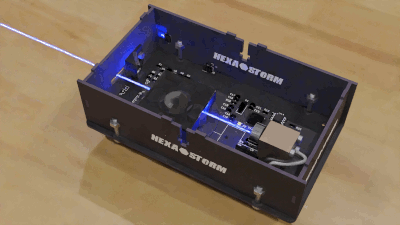
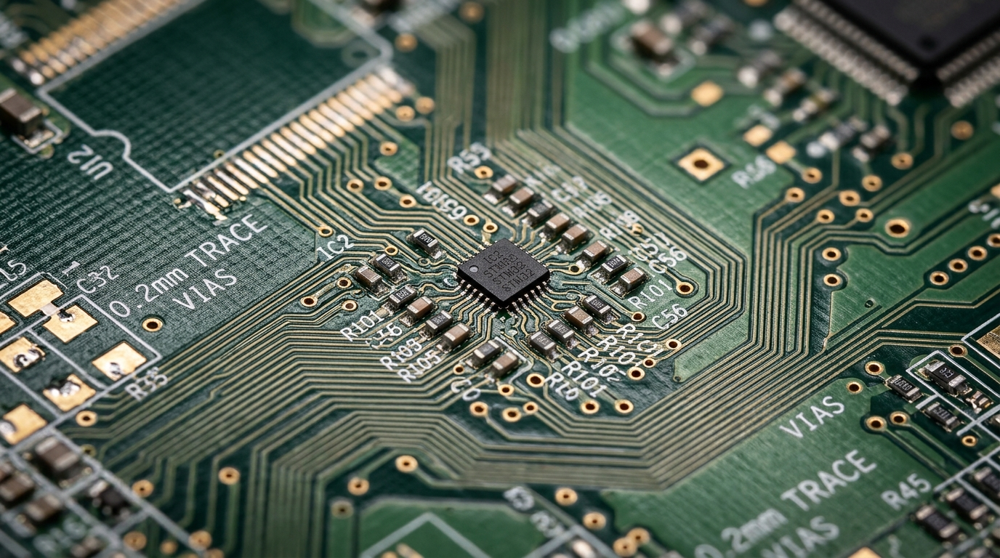
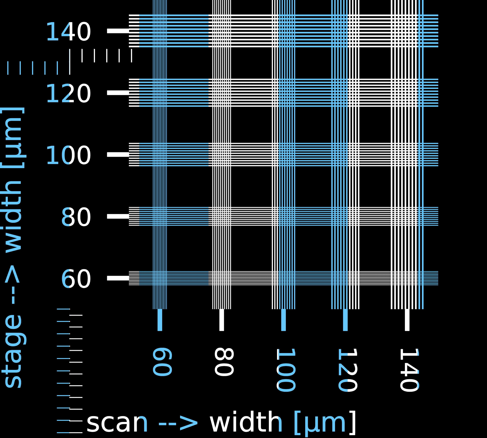
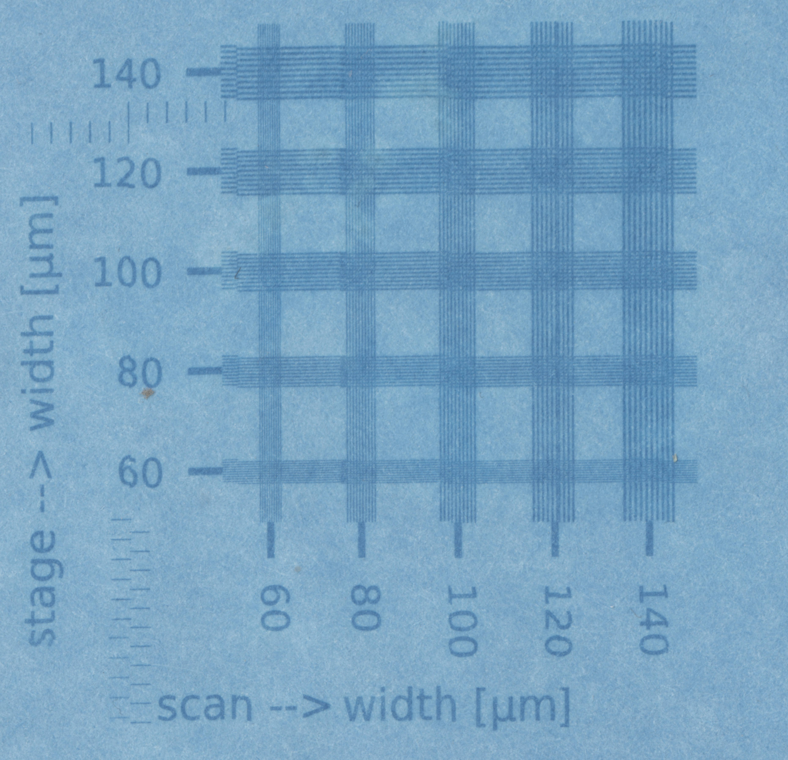

::: {.hero-banner}
::: {.content-block}
::: {.hero-text} 
# Hexastorm {.mt-1}

### High-Speed Laser Direct Imaging for Custom Circuit Boards

::: {.badge-container}
[Sub-60 µm Resolution]{.badge-tag}
[Up to 34 m/s Scan Speed]{.badge-tag}
[CNC 3018 Pro Drop-In Upgrade]{.badge-tag}
[Open-Hardware Gateware & Optics]{.badge-tag}
:::

::: {.hero-actions}
```{=html}
<a href="#what-is-a-pcb" class="btn-secondary-hex">What is a PCB?</a>
<a href="history.html" class="btn-secondary-hex">Read the History</a>
<a href="https://hackaday.io/project/21933-prism-laser-scanner" class="btn-secondary-hex" target="_blank" rel="noopener noreferrer">Hackaday Project Logs</a>
<a href="getstarted.html" class="btn-secondary-hex">Get Started &amp; Code</a>
```
:::

::: {.hero-media}
```{=html}

```
:::

:::
:::
:::

::: {.content-block}

## What is a PCB, and Where Does Hexastorm Fit In? {#what-is-a-pcb}

::: {layout-ncol=2}
{fig-align="center"}

::: {.align-self-center}
Every modern electronic device—from sensors to power electronics—relies on a **Printed Circuit Board (PCB)**: a laminate board patterned with microscopic copper traces connecting chips and discrete components together.

While commercial fab houses (such as [PCBWay](https://www.pcbway.com/)) are the standard for volume multi-layer manufacturing, **Hexastorm brings industrial Laser Direct Imaging (LDI) to your desktop**—eliminating the bottlenecks of rapid prototyping, broken CNC milling bits, and expensive engineering downtime.
:::
:::

```{=html}
<div class="value-accordion">
  <details class="value-item">
    <summary><span class="value-bullet">▸</span> <strong>Rapid R&amp;D Micro-Iterations &amp; Test Coupons</strong></summary>
    <p>When validating a new RF trace, impedance-matched differential pair, or new IC footprint, you don't need a full production board. You need a simple test coupon <em>right now</em>. Hexastorm patterns custom test tracks in minutes rather than burning an entire week.</p>
  </details>

  <details class="value-item">
    <summary><span class="value-bullet">▸</span> <strong>The High Cost of Engineering Downtime (€120+/hr)</strong></summary>
    <p>R&amp;D hardware and optical engineers cost <strong>€120+ per hour</strong>. Waiting 5–7 days for an overseas shipment just to validate a minor track hypothesis stalls project velocity and burns thousands in engineering overhead. Same-afternoon iteration keeps development momentum alive.</p>
  </details>

  <details class="value-item">
    <summary><span class="value-bullet">▸</span> <strong>Exotic &amp; Non-Standard Substrates (Flex, Thick Copper, Curved)</strong></summary>
    <p>Commercial PCB fabs only accept standard, rigid FR4 panels with predefined copper weights. Hexastorm enables direct digital exposure onto materials commercial fabs reject or charge prohibitive tooling fees for: <strong>flexible polyimide (flex circuits), ultra-thick copper busbars, RF ceramics / PTFE, and non-planar or curved substrates</strong>.</p>
  </details>

  <details class="value-item">
    <summary><span class="value-bullet">▸</span> <strong>Non-Contact Laser Precision vs. Fragile CNC Milling</strong></summary>
    <p>Desktop mechanical isolation milling with 0.1 mm V-bits frequently snaps tools, leaves ragged copper burrs, and cannot reliably machine modern fine-pitch surface-mount IC pads. Hexastorm's focused 405 nm laser spot writes <strong>sub-60 micron</strong> features with zero tool wear and zero mechanical force.</p>
  </details>

  <details class="value-item">
    <summary><span class="value-bullet">▸</span> <strong>Accessible Capital with Low Operating Costs</strong></summary>
    <p>Industrial LDI machines cost upwards of €50,000 to €200,000. Hexastorm packages high-speed rotating prism optics into an accessible drop-in light engine for commodity desktop frames. Once your bench setup is in place, routine in-house test exposures avoid rush fees, minimum order quantities, or proprietary consumable markups.</p>
  </details>
</div>
```


## Engineering Overview

Hexastorm is an open-hardware laser scanning engine engineered for rapid, high-resolution raster exposure in printed circuit board photolithography and photopolymer additive manufacturing. 

By replacing slow Cartesian gantries and delicate galvanometer mirrors with a balanced, high-RPM rotating refractive prism, Hexastorm achieves scanning velocities up to **34 meters per second** while maintaining flat-field linearity and sub-micron repeatability.


## System Specifications

::: {.spec-summary-strip}
::: {.spec-item}
[< 60 µm]{.spec-val}
[Demonstrated Resolution]{.spec-lbl}
:::
::: {.spec-item}
[Up to 34 m/s]{.spec-val}
[Linear Scan Speed]{.spec-lbl}
:::
::: {.spec-item}
[405 nm / 500 mW]{.spec-val}
[UV Laser Engine]{.spec-lbl}
:::
::: {.spec-item}
[< 1.0 µm]{.spec-val}
[Repeatability Jitter]{.spec-lbl}
:::
:::

::: {.callout-note collapse="true"}
### View Complete Engineering, Optical & Hardware Specifications (10 Parameters)

<table class="specs-table">
  <thead>
    <tr>
      <th>Parameter</th>
      <th>Specification</th>
      <th>Notes / Performance Context</th>
    </tr>
  </thead>
  <tbody>
    <tr>
      <td><strong>Optical Wavelength</strong></td>
      <td>405 nm</td>
      <td>Single-mode laser diode for UV photoresist & photopolymer resins</td>
    </tr>
    <tr>
      <td><strong>Optical Power</strong></td>
      <td>500 mW</td>
      <td>Modulated via high-speed driver up to 12 MHz</td>
    </tr>
    <tr>
      <td><strong>Rotational Speed</strong></td>
      <td>3,000 – 21,000 RPM</td>
      <td>Driven by custom planar PCB / brushless motor with closed-loop sync</td>
    </tr>
    <tr>
      <td><strong>Linear Scan Speed</strong></td>
      <td>Up to 34 m/s</td>
      <td>At 21,000 RPM across substrate plane (3,000 RPM practical baseline)</td>
    </tr>
    <tr>
      <td><strong>Demonstrated Resolution</strong></td>
      <td>&lt; 60 µm</td>
      <td>Single-facet exposure tests on UV solar photo paper</td>
    </tr>
    <tr>
      <td><strong>Optical Spot Size (FWHM)</strong></td>
      <td>~25 – 40 µm</td>
      <td>Circularized focal spot at target plane</td>
    </tr>
    <tr>
      <td><strong>Repeatability (Jitter)</strong></td>
      <td>&lt; 1.0 µm std dev</td>
      <td>Sub-micron orthogonal and in-scan positional stability</td>
    </tr>
    <tr>
      <td><strong>Control Architecture</strong></td>
      <td>Lattice iCE40UP5K + ESP32-S3</td>
      <td>FPGA microsecond raster gateware + Wi-Fi / motion control</td>
    </tr>
    <tr>
      <td><strong>Hardware Target</strong></td>
      <td>CNC 3018 Pro Drop-In</td>
      <td>Unified 4-layer control board replacing stock 3018 electronics</td>
    </tr>
  </tbody>
</table>
:::


## Verified Physical Exposure Results

The imaging capabilities of the rotating prism engine have been characterized by translating digital lane slices directly into physical raster exposures on photosensitive substrates.

::: {layout-ncol=2}
::: {.image-showcase}
{width=100%}

::: {.image-caption}
**Software Toolchain:** Multi-lane slice preview generated by Hexastorm, dividing vector artwork into parallel high-speed raster scan lanes with registration markers.
:::
:::

::: {.image-showcase}
{width=100%}

::: {.image-caption}
**Physical Exposure:** Single-facet raster exposure test on UV solar photo paper, resolving crisp **sub-60 micron** features. *(Note: Small stitching variations visible across lane boundaries stem from Cartesian CNC stage backlash and mechanical lead-screw tolerances—not the light engine itself, which consistently delivers cycle-accurate spot placement and sharp optical focus across every sweep).*
:::
:::
:::


## Recent Breakthroughs

::: {.card-grid}

::: {.feature-card}
#### Deterministic Gateware Debounce
By developing custom Amaranth HDL gateware ([`photodiode_debounce.py`](https://github.com/hstarmans/hexastorm/blob/master/src/hexastorm/blocks/photodiode_debounce.py)), electrical noise and optical ringing on the sync photodiode are completely eliminated. This provides cycle-accurate, sub-microsecond timing baselines on every revolution.
:::

::: {.feature-card}
#### Sub-Micron OpenCV Metrology
During bench calibration with a stationary global shutter sensor (OV2311), custom OpenCV algorithms quantify orthogonal tilt and in-scan timing jitter across 10 consecutive sweeps per facet, delivering sub-micron standard deviations (0.25–0.8 µm orthogonal, 0.47–1.0 µm in-scan).
:::

::: {.feature-card}
#### Drop-In CNC 3018 Pro Integration
To eliminate the barrier of custom mechanical chassis, the 2026 electronics are integrated into a single 4-layer PCB ([Firestarter](https://github.com/hstarmans/firestarter)). It drops directly into the standard enclosure of the widely available CNC 3018 Pro desktop machine, retaining its power supply, frame, and cabling.
:::

::: {.feature-card}
#### End-to-End Open Toolchain
From KiCad SVG vector imports and FPGA gateware to Python optical simulation in [pyoptools](https://github.com/pyoptools/pyoptools) and [opticaldesign](https://github.com/hexastorm/opticaldesign), every layer of the hardware and software stack is fully documented and open.
:::

:::


## Manufacturing & Support

::: {.partner-banner}
::: {.partner-brand}
<a href="https://www.pcbway.com/" target="_blank" rel="noopener noreferrer">
  
</a>

::: {.partner-text}
##### Fabricated with Support from PCBWay
The unified 4-layer **Firestarter** control board (combining the ESP32-S3, Lattice iCE40UP5K FPGA, TMC2209 silent stepper drivers, and 24V power tree onto an 88 × 70 mm footprint) was manufactured and sponsored by [PCBWay](https://www.pcbway.com/).
:::
:::

[Visit PCBWay](https://www.pcbway.com/){.btn-secondary-hex target="_blank"}
:::

:::